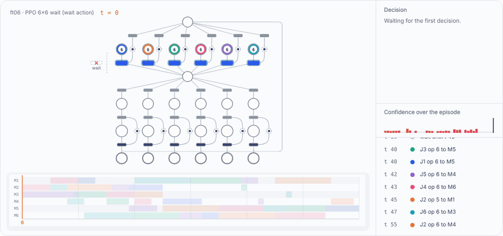

# PetriRL Studio

**The power of discrete optimization in one place.** Version 0.7

Schedule job shops with reinforcement learning agents, dispatching rules and metaheuristics on a colored timed
Petri net, compare the results and replay every decision. Part of the
[PetriRL framework](https://github.com/Sofiene-Uni/PetriRL-Framework).

**Try it live: [petrirl.de](https://petrirl.de)** (free research demonstrator), or host it yourself for
noncommercial use (below).



## Features

- **Solve** 242 classic benchmarks or your own instances with RL agents, 15 dispatching rules or 3 metaheuristics
  (genetic algorithm, simulated annealing, tabu search). Every run shows its gap to the best known solution.
- **Train** MaskablePPO agents with a live learning curve; save milestones without stopping.
- **Three environments**: dispatching (one job per action), OR-informed (imitation of tabu search, then PPO) and
  hyper-heuristic (one dispatching rule per action).
- **Replay** every run on the Petri net with the Gantt chart, masked actions and the agent's confidence.
- English and German, light and dark theme.

## Run it

```bash
git clone https://github.com/Sofiene-Uni/PetriRL-Studio.git
cd PetriRL-Studio
pip install torch --index-url https://download.pytorch.org/whl/cpu
pip install -r requirements.txt
python run.py          # http://localhost:5000
```

Or with Docker: `docker compose up -d --build`. Data is kept in `./data`, outside the container.

Tests: `pip install -r requirements-dev.txt && pytest`. How to edit pages, texts and translations:
[MAINTAINING.md](MAINTAINING.md).

## Team

- [Sofiene Lassoued](https://www.fh-swf.de/de/ueber_uns/standorte_4/soest_4/fb_eet/doz_eet/mitarbeiter_4/lassoued/index.php),
  doctoral researcher, author
- [Prof. Dr.-Ing. Andreas Schwung](https://www.fh-swf.de/de/ueber_uns/standorte_4/soest_4/fb_eet/doz_eet/profs_eet/schwung/index.php),
  supervisor
- [Laboratory for Automation Technology and Learning Systems](https://www.fh-swf.de/de/forschung___transfer_4/labore_3/labs/labor_fuer_automatisierungstechnik__soest_1/standardseite_57.php),
  FH SWF, Soest

## License and citation

Free for noncommercial use under the [PolyForm Noncommercial License 1.0.0](LICENSE). Any other use needs written
permission: [sofiene.lassoued.org](https://sofiene.lassoued.org). Third-party licenses: [NOTICE](NOTICE).
By opening a pull request you agree that the authors may also license your contribution under other terms.

Please cite:

```bibtex
@article{lassoued2024petrirl,
  title   = {Introducing PetriRL: An innovative framework for JSSP resolution integrating Petri nets and event-based reinforcement learning},
  author  = {Lassoued, Sofiene and Schwung, Andreas},
  journal = {Journal of Manufacturing Systems},
  volume  = {74},
  pages   = {690--702},
  year    = {2024},
  doi     = {10.1016/j.jmsy.2024.04.028}
}
```
