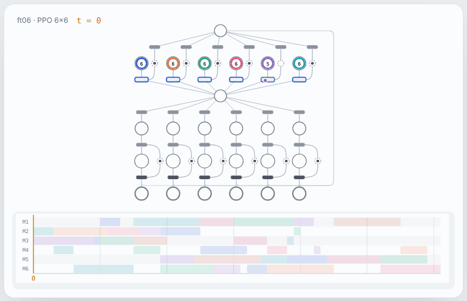
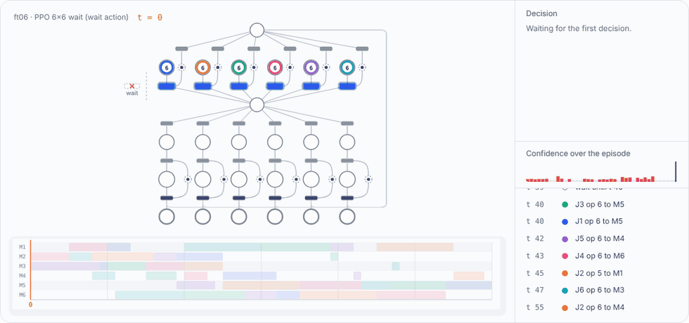

# PetriRL Studio

**PetriRL: the power of discrete optimization in one place.** Version 0.7

AI agents trained with reinforcement learning plan your orders, side by side with proven heuristics and
metaheuristics, on a light digital twin of your production: a colored timed Petri net. Compare every method, keep
the best plan, and replay every decision. Part of the [PetriRL framework](https://github.com/Sofiene-Uni/PetriRL-Framework).
Built for small and medium-sized manufacturers.



## Features

- **Solve** your own instances (drag and drop, or random) or 242 classic benchmarks (Taillard, Demirkol, Lawrence,
  Fisher and Thompson, ...) with RL agents, 15 dispatching rules or 3 metaheuristics (genetic algorithm, simulated
  annealing, tabu search, with their settings and an optional wait action). Every run shows its gap to the optimum
  or best known solution.
- **Train** MaskablePPO agents with any training budget, a live learning curve, steps and episodes per second, and
  milestones: save the current agent to the library without stopping the training.
- **Environments**, chosen once on the home page:
  - Dispatching: one action releases one job onto its next machine, optionally wait.
  - OR-informed: tabu search solves the training instances, the agent clones its decisions, then PPO fine-tunes.
  - Hyper-heuristic: one action picks one of 14 dispatching rules for the next k decisions.
- **Plan**: interactive Gantt chart with job routes and critical path, export as CSV, PNG or SVG.
- **Replay** every run on the Petri net, with enabled and masked actions, the agent's probabilities and confidence.
- **Solutions**: upload your own (machine orders or a firing sequence) or replay the best known Taillard solutions
  from [optimizizer.com](https://optimizizer.com/TA.php) (Oleg Shylo). Each one is fetched once and stored;
  `python tools/fetch_known_solutions.py` ships all of them with the app.
- **Benchmarks** page: every family with its proven lower bound and best known solution.
- **English and German** (EN | DE), light and dark theme. Technology, About and Contact are plain HTML templates,
  see [MAINTAINING.md](MAINTAINING.md).



## Quick start

```bash
git clone https://github.com/Sofiene-Uni/PetriRL-Studio.git
cd PetriRL-Studio
pip install -r requirements.txt
python run.py          # http://localhost:5000
```

Tests: `pip install -r requirements-dev.txt && pytest`

### Docker

```bash
docker compose up -d --build   # http://<host>:5000
```

The app keeps everything it writes in a folder of the server, not in the container: `./data` next to
`docker-compose.yml` (set `PETRIRL_DATA_PATH` to put it elsewhere, e.g. `/srv/petrirl`). Rebuilding or replacing the
container keeps it; back it up by copying the folder.

```
data/
  instances/    uploaded and generated instances
  agents/       trained and uploaded agents (.zip + .json)
  runs/         solved runs (plans, replays) + index.jsonl
  solutions/    best known solutions, fetched once
  visitors.json visit count
```

The container uses one CPU core. Solving and training wait in one line: one job computes at a time and the others
see their place ("Sorry, the server is busy. You are 2nd in line."). Change this in `docker-compose.yml`
(`cpus`, `PETRIRL_COMPUTE_SLOTS`, `PETRIRL_QUEUE_MAX`). In a Proxmox LXC container, enable `nesting` and `keyctl`
to run Docker.

## Structure

```
engine/     Petri net, simulator, gym environments, rules, metaheuristics, imitation (no web dependency)
studio/     Flask app: blueprints (pages, /api), services, templates, i18n (German texts), static (JS, CSS)
stock/      benchmark instances, pretrained demo agents, shipped solutions
tools/      stock agent training, benchmark import, solution download, front-end checks
tests/      engine and API tests
```

## Team

- [Sofiene Lassoued](https://www.fh-swf.de/de/ueber_uns/standorte_4/soest_4/fb_eet/doz_eet/mitarbeiter_4/lassoued/index.php),
  doctoral researcher, author of PetriRL and PetriRL Studio
- [Prof. Dr.-Ing. Andreas Schwung](https://www.fh-swf.de/de/ueber_uns/standorte_4/soest_4/fb_eet/doz_eet/profs_eet/schwung/index.php),
  supervisor
- [Laboratory for Automation Technology and Learning Systems](https://www.fh-swf.de/de/forschung___transfer_4/labore_3/labs/labor_fuer_automatisierungstechnik__soest_1/standardseite_57.php),
  South Westphalia University of Applied Sciences (FH SWF), Soest

## License and citation

Free for noncommercial use under the [PolyForm Noncommercial License 1.0.0](LICENSE). For commercial use, the
solution is for sale or open to cooperation: [sofiene.lassoued.org](https://sofiene.lassoued.org).

Please cite the PetriRL paper when the app or its results appear in scientific work:

```bibtex
@article{lassoued2024petrirl,
  title   = {Introducing PetriRL: An innovative framework for JSSP resolution integrating Petri nets and event-based reinforcement learning},
  author  = {Lassoued, Sofiene and Schwung, Andreas},
  journal = {Journal of Manufacturing Systems},
  volume  = {74},
  pages   = {690--702},
  year    = {2024},
  doi     = {10.1016/j.jmsy.2024.04.028}
}
```
